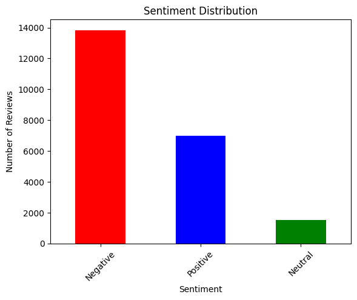
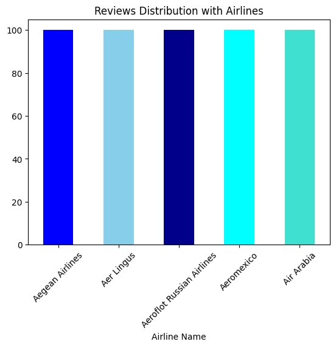
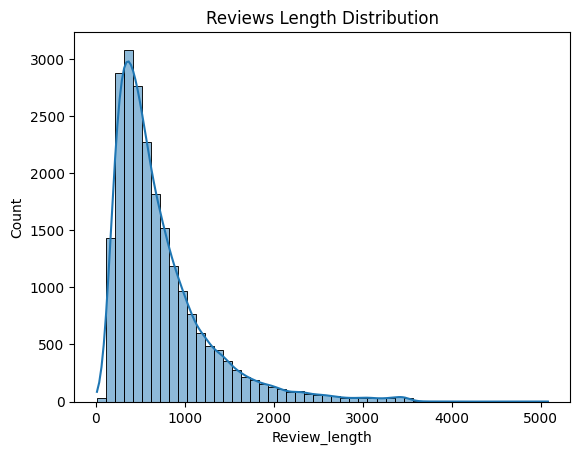
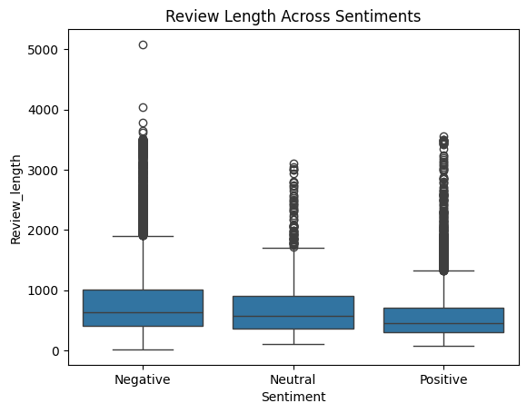
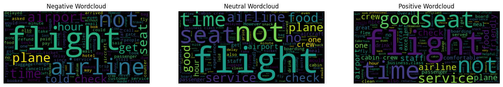
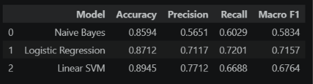
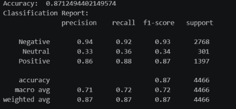
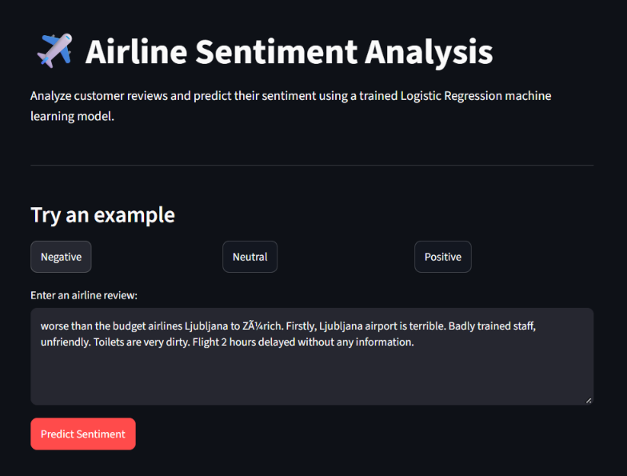
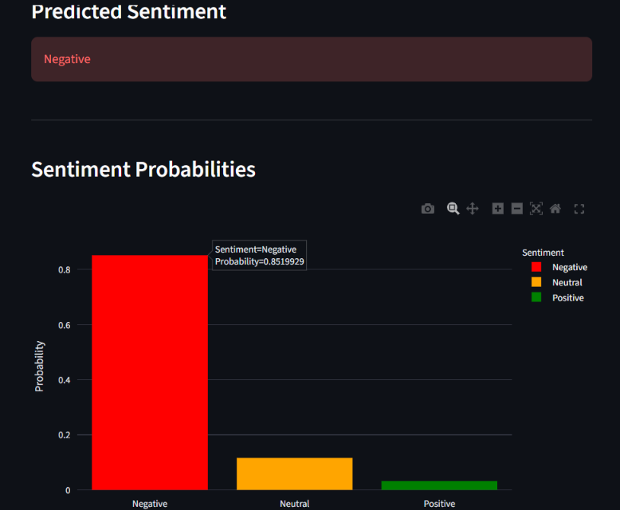

# Airline Sentiment Analysis

## Overview and Objective

Airlines receive thousands of written feedback than anyone can read and manually analysing each review can be time-consuming. 
This project classifies airline reviews as Negative, Neutral or Positive so feedback can be monitored automatically. The final model is provided through a small Streamlit app.


Live Demo: https://airline-sentiment-analysis-gravionic.streamlit.app/

---
 
## Dataset

The project uses an airline customer reviews dataset containing 23,171 records covering 497 airlines, each with a star rating, review title, review text and a recommend yes/no flag.

**Source:** https://www.kaggle.com/datasets/juhibhojani/airline-reviews

---

## Project Structure
```
airline-sentiment-analysis/
│
├── app
│
├── data
│
├── images
│
├── model
│
├── notebooks
│
├── README.md
│
└── requirement
```
---

## Installations


### Clone the repository

```bash
git clone https://github.com/gravionic/airline-sentiment-analysis.git
cd airline-sentiment-analysis
```

### Technologies

`Python` `Pandas` `NumPy` `Scikit-learn` `NLTK` `Wordcloud` `Streamlit` `Matplotlib` `Seaborn` `CountVectorizer` `TF-IDFvectorizer` `PlotlyExpress` `Joblib`

```bash
pip install -r requirements.txt
```

---

## Approach

### Data Cleaning and Labelling 

Unrated reviews were removed. About 2,270 reviews rated "1" were already labelled `Recommended = yes`, which means the scraper cut "10" to "1". These were corrected to 10. After the fix, the labels agree with the Recommended column 98-99% of the time for Negative and Positive reviews. The data has no sentiment column, so labels come from the star rating: 1-4 Negative, 5-6 Neutral, 7-10 Positive. 

### Exploratory Data Analysis

In EDA, following charts were plotted and examined:

- Distribution of customer sentiment.



- Review distribution across airlines.



- Review length distribution.



- Differences in review length across sentiment categories.



- Frequently occurring terms using sentiment-specific word clouds.



Approximately 98.8% of Negative reviews were marked as not recommended while approximately 98.5% of Positive reviews were marked as recommended. Neutral reviews were almost evenly divided between the two recommendation categories.

### Text Preprocessing 

The title and review are combined, lowercased, and stripped of punctuation, digits and non-ASCII characters. They are then tokenized and stopwords are removed, keeping negation words (such as "not" and "never"), so phrases like "not good" stay intact.

### Feature Extraction

Text data was converted into numerical representations using two approaches:

- Bag-of-Words (CountVectorizer): Represents text using token frequency.
- TF-IDF (TfidfVectorizer): Assigns weights based on the importance of terms across the documents.

Both approaches used unigrams and bigrams (ngram_range=(1,2)) to capture individual words as well as two-word expressions.

### Model Development

he following machine learning models were trained and evaluated:
|Model|Feature Extraction|
|----------------------|-----------:|
|Multinomial Naive Bayes|	Bag-of-Words|
|Multinomial Naive Bayes|	TF-IDF|
|Logistic Regression|	Bag-of-Words|
|Logistic Regression|	TF-IDF|
|Linear SVM|	TF-IDF|

An 80/20 stratified train-test split was used to maintain the sentiment distribution across train-test data and balanced class weight was applied to handle the small neutral class.

### Model Evaluation 

Models were evaluated using Accuracy, Macro Precision, Macro Recall, and Macro F1-score.

Macro-averaged metrics were particularly important because they assign equal importance to each sentiment class, rather than allowing the majority classes to dominate the evaluation.



### Final Model Selection 

Logistic Regression with TF-IDF was selected as the final model. I chose the model by macro-F1, not accuracy. The SVM has higher accuracy, but it misses most Neutral reviews (recall 0.12), so its macro-F1 is lower. 



---

## Key Findings

- The model with the highest accuracy was not necessarily the best overall model. Evaluating macro-averaged metrics helped identify a more balanced classifier for an imbalanced three-class sentiment problem.
- Neutral is the hardest class. Reviewers who gave 5-6 stars are split 50/50 on recommending the airline, so there is no clean signal for a text model to learn.

---

## Limitations

- The dataset contains a significant class imbalance, particularly for Neutral reviews and therefore Neutral sentiment is more difficult to distinguish from Negative and Positive sentiment.
- Sentiment labels are derived from star ratings, not human annotation so they may not always perfectly represent the actual meaning of the written review.

---

## Streamlit Application

The trained model is integrated into an interactive Streamlit application, allowing users to:

- Enter an airline review and receive its predicted sentiment.
- Interact with bar chart displaying the model's predicted probabilities for all three classes.
- Try example reviews and get the sentiment prediction.




---

## Future Improvements 

- Extend the app to support CSV uploads and analyse multiple customer reviews simultaneously.
- Experiment with advanced NLP approaches such as Word2Vec, LSTM or try a fine-tuned transformer (such as DistilBERT) to capture context and mixed opinions.
- Explore additional techniques for addressing class imbalance and improving the model's ability to distinguish Neutral reviews.

---

## Author

Mohit

